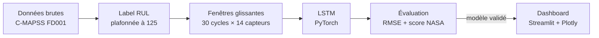

# Industrial Predictive Maintenance Copilot

**Prédire combien de cycles il reste à un turboréacteur avant sa panne (RUL), et transformer cette prédiction en supervision exploitable.**

[](https://www.python.org/)
[](https://pytorch.org/)
[](https://streamlit.io/)
[](LICENSE)


---

## Sommaire

- [Le problème](#le-problème)
- [Démo](#démo)
- [Résultats](#résultats)
- [Architecture](#architecture)
- [Décisions d'ingénierie clés](#décisions-dingénierie-clés)
- [Stack technique](#stack-technique)
- [Lancer le projet](#lancer-le-projet)
- [Structure du projet](#structure-du-projet)
- [Feuille de route](#feuille-de-route)
- [Licence](#licence)

---

## Le problème

| Approche | Principe | Limite |
|---|---|---|
| **Réactive** | On répare après la panne. | Arrêt imprévu, coût élevé, risque pour la sécurité. |
| **Préventive** | On intervient à intervalles fixes. | On remplace souvent trop tôt, parfois trop tard. |
| **Prédictive** | On estime la **durée de vie résiduelle (RUL)** de chaque machine à partir de ses capteurs. | C'est l'objet de ce projet : intervenir au bon moment. |

## Démo

Le dashboard Streamlit adopte un style « salle de contrôle ». Il classe chaque moteur selon son niveau de risque : **critique** (RUL < 30 cycles), **alerte** (30 à 60) ou **sain** (≥ 60).

<table>
  <tr>
    <td width="50%"></td>
    <td width="50%"></td>
  </tr>
  <tr>
    <td><b>Vue Flotte</b> : RUL prédite pour les 100 moteurs, triée par urgence, avec un registre et des badges de statut.</td>
    <td><b>Vue Moteur</b> : jauge de RUL et capteurs principaux. La zone grisée correspond à la fenêtre de 30 cycles lue par le modèle.</td>
  </tr>
</table>

## Résultats

Évaluation sur le jeu de **test** officiel FD001. Chaque moteur de test est évalué sur sa dernière fenêtre de 30 cycles, et la vraie RUL est plafonnée à 125, comme dans la littérature.

| Dataset | Modèle | RMSE test ↓ | Score NASA ↓ |
|---|---|---|---|
| NASA C-MAPSS **FD001** (100 moteurs) | LSTM 2 couches, hidden 64, fenêtre 30 × 14 capteurs | **13.47 cycles** | **318.5** |


- **Proche de la panne** (RUL < 30) : les prédictions collent à la réalité. C'est la zone où une erreur coûte le plus cher.
- **Milieu de vie** (RUL de 40 à 100) : l'erreur est plus forte, car le signal de dégradation y est encore faible.
- **Score NASA** : la pénalité est asymétrique. Une prédiction **tardive** coûte plus cher qu'une prédiction précoce, car le moteur risque de casser avant l'intervention.
- Ce résultat provient d'un seul entraînement (graine 42).

## Architecture



| Étape | Module | Rôle |
|---|---|---|
| Données | [`src/data/load.py`](src/data/load.py) | Lecture des fichiers bruts, 26 colonnes nommées |
| Label RUL | [`src/data/labeling.py`](src/data/labeling.py) | RUL = cycle max − cycle courant, plafonnée |
| Préparation | [`src/data/preprocess.py`](src/data/preprocess.py) | 14 capteurs utiles, normalisation min-max |
| Fenêtres | [`src/data/windows.py`](src/data/windows.py) | Fenêtres glissantes `(n, 30, 14)`, découpées par moteur |
| Modèle | [`src/models/lstm.py`](src/models/lstm.py), [`train.py`](src/models/train.py) | LSTM, validation par moteur, sauvegarde du meilleur modèle |
| Évaluation | [`src/models/evaluate.py`](src/models/evaluate.py) | RMSE, score NASA, graphique prédit vs réel |
| Prédiction | [`src/models/predict.py`](src/models/predict.py) | Chargement du modèle et prédiction, partagés par l'évaluation et le dashboard |
| Dashboard | [`src/dashboard/app.py`](src/dashboard/app.py) | Vues Flotte et Moteur |

L'exploration des données est dans [`notebooks/01_eda.ipynb`](notebooks/01_eda.ipynb).

## Décisions d'ingénierie clés

**1. RUL plafonnée à 125 cycles (piecewise-linear)**
En début de vie, un moteur est sain et ses capteurs sont stables : rien ne permet de distinguer une RUL de 300 d'une RUL de 150. Demander au modèle de prédire ces valeurs ne ferait qu'ajouter du bruit. La cible reste donc constante à 125, puis décroît linéairement jusqu'à 0. Pendant l'entraînement, elle est divisée par 125 (entre 0 et 1), ce qui accélère nettement l'apprentissage. Sans cette division, la RMSE de validation était encore de 47 après 20 epochs ; avec, elle descend à environ 16 dès la 5ᵉ epoch.

**2. Fenêtres glissantes de 30 cycles**
La dégradation est une **tendance**, invisible sur un seul point de mesure. Le LSTM lit donc 30 cycles consécutifs et prédit la RUL au dernier. Les fenêtres sont découpées **moteur par moteur**, si bien qu'aucune ne mélange deux moteurs. Sur le test, seule la dernière fenêtre de chaque moteur est utilisée, comme en conditions réelles.

**3. Normalisation sans fuite de données**
- La validation (80/20) se fait **par moteur** : les cycles d'un même moteur ne se retrouvent jamais des deux côtés.
- Le scaler min-max est appris (`fit`) sur les seuls moteurs d'entraînement. Validation et test ne passent que par `transform`.
- Les 7 capteurs constants en FD001 (repérés pendant l'exploration des données) sont retirés.

**4. Une seule source de vérité pour la prédiction**
[`src/models/predict.py`](src/models/predict.py) contient le seul code qui charge le modèle et calcule une RUL (dernière fenêtre, × 125, bornage dans [0, 125]). L'évaluation et le dashboard l'importent tous deux : le chiffre affiché à l'écran est celui qui est mesuré. Les paramètres (fenêtre, plafond, liste des capteurs) sont enregistrés **dans le checkpoint** et ne sont pas redéfinis ailleurs.

## Stack technique

| Domaine | Outils |
|---|---|
| Langage | Python 3.13 |
| Deep learning | PyTorch |
| Données & ML | pandas, NumPy, scikit-learn |
| Visualisation | Plotly, Matplotlib |
| Dashboard | Streamlit |

## Lancer le projet

**1. Installation**

```bash
git clone https://github.com/atef-hadef/industrial-pdm-copilot.git
cd industrial-pdm-copilot
python -m venv venv
venv\Scripts\activate            # Windows — Linux/macOS : source venv/bin/activate
pip install -r requirements.txt
```

**2. Données** : le dataset n'est pas versionné. Téléchargez [NASA Turbofan Jet Engine Data Set](https://www.kaggle.com/datasets/behrad3d/nasa-cmaps) sur Kaggle (copie du jeu C-MAPSS de la NASA, licence CC0). Placez ensuite `train_FD001.txt`, `test_FD001.txt` et `RUL_FD001.txt` dans `data/raw/`.

```bash
python -m src.data.load              # vérifie le chargement (shapes attendues)
```

**3. Entraînement** : environ 2 minutes sur CPU. Le meilleur modèle et le scaler sont créés dans `models/`.

```bash
python -m src.models.train
```

**4. Évaluation** : la commande affiche la RMSE et le score NASA, et enregistre le graphique dans `reports/eval_fd001.png`.

```bash
python -m src.models.evaluate
```

**5. Dashboard** : à lancer depuis la racine du repo, pour que le thème `.streamlit/config.toml` soit appliqué.

```bash
streamlit run src/dashboard/app.py
```

## Structure du projet

```
industrial-pdm-copilot/
├── assets/                 GIF, captures et graphiques du README
├── data/
│   ├── raw/                C-MAPSS brut (non versionné)
│   └── processed/          données préparées (non versionné)
├── manuals/                base documentaire du futur copilote RAG
├── models/                 modèle entraîné + scaler (générés, non versionnés)
├── notebooks/
│   └── 01_eda.ipynb        exploration de FD001
├── src/
│   ├── data/               chargement, label RUL, normalisation, fenêtres
│   ├── models/             LSTM, entraînement, évaluation, prédiction
│   ├── dashboard/          application Streamlit
│   ├── api/                (palier 2) API FastAPI
│   ├── mlops/              (palier 2) MLflow, suivi de dérive
│   └── rag/                (palier 3) copilote IA générative
├── tests/
├── .streamlit/config.toml  thème sombre du dashboard
├── CHANGELOG.md
├── LICENSE
└── requirements.txt
```

## Feuille de route

- [x] **Palier 1 : MVP ML.** Exploration des données, labels RUL, LSTM, évaluation RMSE + score NASA, dashboard.
- [ ] **Palier 2 : MLOps.**
  - suivi des expériences et registre de modèles avec **MLflow** ;
  - API **FastAPI** (`/predict`, `/health`) ;
  - conteneurisation **Docker** / docker-compose ;
  - surveillance de la dérive des données ;
  - tests et CI.
- [ ] **Palier 3 : Copilote IA générative (RAG).** Un agent qui part d'un moteur à risque, retrouve les procédures pertinentes dans `manuals/`, explique le diagnostic en **citant ses sources**, puis rédige un **ordre de travail** structuré (actions, priorité, fenêtre d'arrêt).

L'historique détaillé des évolutions est dans [CHANGELOG.md](CHANGELOG.md).

## Licence

Distribué sous licence MIT. Voir [LICENSE](LICENSE).
© 2026 Atef Ben Hadef
