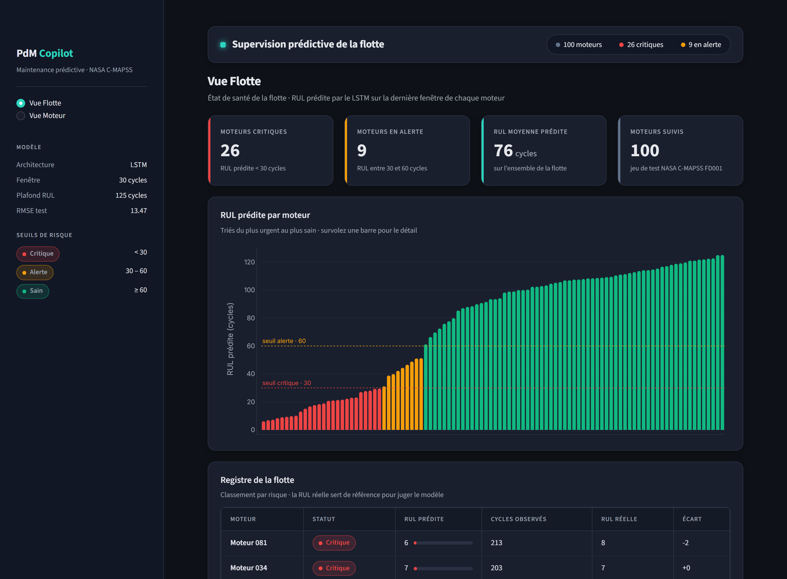
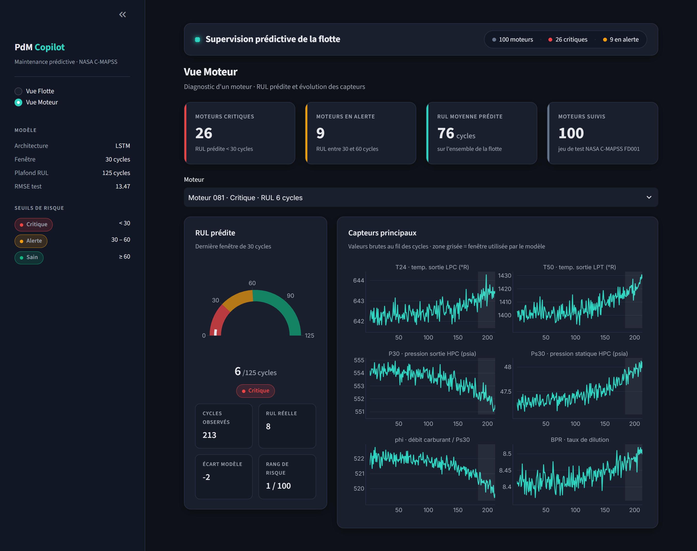

# Industrial Predictive Maintenance Copilot

> Prédire combien de cycles il reste à un turboréacteur avant sa panne (RUL), et présenter cette prédiction dans un tableau de bord de supervision prêt à l'emploi.


---

## Le problème

- **Maintenance réactive** : on répare après la panne. Cela entraîne un arrêt imprévu, un coût élevé et un risque pour la sécurité.
- **Maintenance préventive** : on intervient à intervalles fixes, que la pièce soit usée ou non. On remplace souvent trop tôt, et parfois trop tard.
- **Maintenance prédictive** : on estime la **durée de vie résiduelle (RUL)** de chaque machine à partir de ses capteurs, puis on intervient au bon moment. C'est l'objet de ce projet.

## Démo

**Vue Flotte** : RUL prédite pour les 100 moteurs, classés par risque (critique < 30 cycles, alerte 30 à 60, sain ≥ 60).



**Vue Moteur** : jauge de RUL et capteurs principaux d'un moteur. La zone grisée correspond aux 30 derniers cycles, ceux que lit le modèle.



## Résultats

| Élément | Valeur |
|---|---|
| Dataset | NASA C-MAPSS **FD001** (100 moteurs de test, 1 condition de vol, 1 mode de défaillance) |
| Modèle | LSTM 2 couches (hidden 64), fenêtres de 30 cycles, 14 capteurs |
| **RMSE test** | **13.47 cycles** |
| **Score NASA** | **318.5** |

- **Protocole** : chaque moteur de test est évalué sur sa dernière fenêtre de 30 cycles. La vraie RUL est plafonnée à 125, comme dans la littérature.
- **Score NASA** : cette pénalité est asymétrique. Une prédiction **tardive** coûte plus cher qu'une prédiction précoce, car le moteur risque de casser avant l'intervention. Plus le score est bas, mieux c'est.
- Ce résultat provient d'un seul entraînement (graine 42).

## Architecture

```
 C-MAPSS brut (train / test / RUL)
        │
        ▼
 [1] Données        src/data/load.py         lecture, 26 colonnes nommées
        │
        ▼
 [2] Label RUL      src/data/labeling.py     RUL = cycle max − cycle courant, plafonnée à 125
        │
        ▼
 [3] Préparation    src/data/preprocess.py   14 capteurs utiles, min-max appris sur le train seul
        │           src/data/windows.py      fenêtres glissantes (n, 30, 14) par moteur
        ▼
 [4] Modèle         src/models/lstm.py       LSTM → RUL du dernier cycle de la fenêtre
        │           src/models/train.py      split 80/20 par moteur, MSE + Adam, meilleur modèle sauvegardé
        ▼
 [5] Évaluation     src/models/evaluate.py   dernière fenêtre de chaque moteur de test → RMSE + score NASA
        │
        ▼
 [6] Dashboard      src/dashboard/app.py     Streamlit + Plotly : vue flotte, vue moteur
```

Trois choix évitent les fuites de données :
- la validation se fait sur des **moteurs** jamais vus, et non sur des lignes tirées au hasard ;
- le scaler est appris uniquement sur les moteurs d'entraînement ;
- le test n'est utilisé qu'en `transform`, jamais en `fit`.

L'exploration des données est dans [notebooks/01_eda.ipynb](notebooks/01_eda.ipynb). Elle montre notamment que 7 capteurs sont constants en FD001 et sont donc retirés.

## Stack technique

| Domaine | Outils |
|---|---|
| Langage | Python |
| Deep learning | PyTorch |
| Données & ML | pandas, NumPy, scikit-learn |
| Visualisation | Plotly, Matplotlib |
| Dashboard | Streamlit |

## Lancer le projet

**1. Installation** (Python 3.11 ou plus récent)

```bash
git clone <url-du-repo>
cd <dossier-du-repo>
python -m venv venv
venv\Scripts\activate            # Windows — Linux/macOS : source venv/bin/activate
pip install -r requirements.txt
```

**2. Données** : le dataset n'est pas versionné. Téléchargez NASA C-MAPSS depuis le [NASA Prognostics Data Repository](https://www.nasa.gov/intelligent-systems-division/discovery-and-systems-health/pcoe/pcoe-data-set-repository/) ou depuis Kaggle (« NASA CMAPSS »). Placez ensuite `train_FD001.txt`, `test_FD001.txt` et `RUL_FD001.txt` dans `data/raw/`.

Pour vérifier le chargement :
```bash
python -m src.data.load
```

**3. Entraînement** : environ 2 minutes sur CPU. Le meilleur modèle et le scaler sont créés dans `models/`.
```bash
python -m src.models.train
```

**4. Évaluation sur le test** : la commande affiche la RMSE et le score NASA, et enregistre le graphique `reports/eval_fd001.png`.
```bash
python -m src.models.evaluate
```

**5. Dashboard** : à lancer depuis la racine du repo, pour que le thème `.streamlit/config.toml` soit appliqué.
```bash
streamlit run src/dashboard/app.py
```

## Structure du projet

```
.
├── assets/                 captures du dashboard (README)
├── data/
│   ├── raw/                C-MAPSS brut (non versionné)
│   └── processed/          données préparées (non versionné)
├── manuals/                base documentaire du futur copilote RAG
├── models/                 modèle entraîné + scaler (générés, non versionnés)
├── notebooks/
│   └── 01_eda.ipynb        exploration de FD001
├── src/
│   ├── data/               chargement, label RUL, normalisation, fenêtres
│   ├── models/             LSTM, entraînement, évaluation, prédiction
│   ├── dashboard/          application Streamlit
│   ├── api/                (palier 2) API FastAPI
│   ├── mlops/              (palier 2) MLflow, suivi de dérive
│   └── rag/                (palier 3) copilote IA générative
├── tests/
├── .streamlit/config.toml  thème sombre du dashboard
├── CHANGELOG.md
├── Industrial-PdM-Copilot_SPEC.md   cahier des charges technique
└── requirements.txt
```

## Feuille de route

- [x] **Palier 1 : MVP ML.** Exploration des données, labels RUL, LSTM, évaluation RMSE + score NASA, dashboard.
- [ ] **Palier 2 : MLOps.**
  - suivi des expériences et registre de modèles avec **MLflow** ;
  - API **FastAPI** (`/predict`, `/health`) ;
  - conteneurisation **Docker** / docker-compose ;
  - surveillance de la dérive des données ;
  - tests et CI.
- [ ] **Palier 3 : Copilote IA générative (RAG).** Un agent qui part d'un moteur à risque, retrouve les procédures pertinentes dans `manuals/`, explique le diagnostic en **citant ses sources**, puis rédige un **ordre de travail** structuré (actions, priorité, fenêtre d'arrêt).

L'historique détaillé des évolutions est dans [CHANGELOG.md](CHANGELOG.md).
