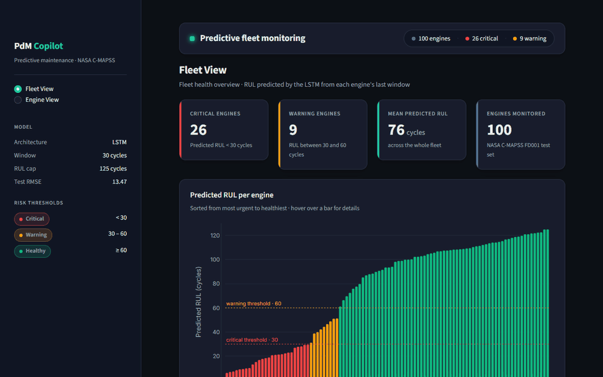
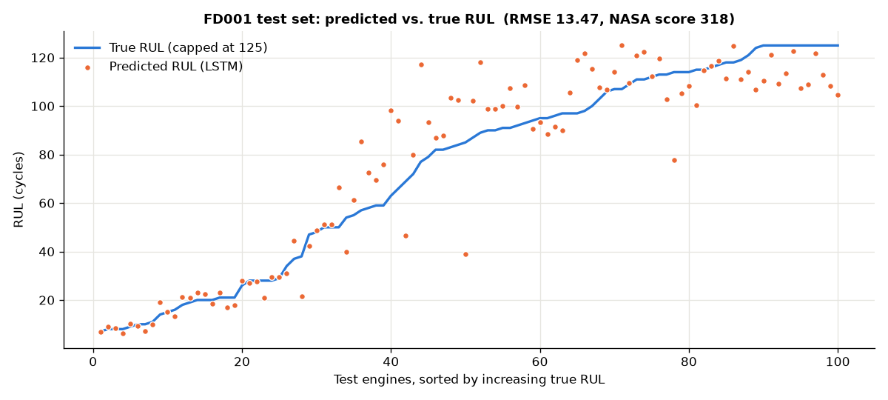
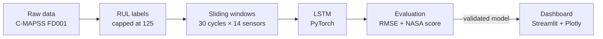

# Industrial Predictive Maintenance Copilot

**Predict how many cycles a turbofan engine has left before failure (RUL), and turn that prediction into actionable fleet monitoring.**

[](https://www.python.org/)
[](https://pytorch.org/)
[](https://streamlit.io/)
[](LICENSE)



---

## Table of Contents

- [The Problem](#the-problem)
- [Demo](#demo)
- [Results](#results)
- [Architecture](#architecture)
- [Key Engineering Decisions](#key-engineering-decisions)
- [Tech Stack](#tech-stack)
- [Getting Started](#getting-started)
- [Project Structure](#project-structure)
- [Roadmap](#roadmap)
- [License](#license)

---

## The Problem

| Approach | How it works | Drawback |
|---|---|---|
| **Reactive** | Fix it after it breaks. | Unplanned downtime, high cost, safety risk. |
| **Preventive** | Service at fixed intervals. | Parts are often replaced too early, sometimes too late. |
| **Predictive** | Estimate each machine's **Remaining Useful Life (RUL)** from its sensor data. | This project's goal: intervene at the right time. |

## Demo

The Streamlit dashboard uses a "control room" look. It ranks every engine by risk level: **critical** (RUL < 30 cycles), **warning** (30 to 60) or **healthy** (≥ 60).

<table>
  <tr>
    <td width="50%"></td>
    <td width="50%"></td>
  </tr>
  <tr>
    <td><b>Fleet view</b>: predicted RUL for all 100 engines, sorted by urgency, with a fleet registry and status badges.</td>
    <td><b>Engine view</b>: RUL gauge and key sensor trends. The shaded area is the 30-cycle window fed to the model.</td>
  </tr>
</table>

## Results

Evaluated on the official FD001 **test** set. Each test engine is scored on its last 30-cycle window, and the ground-truth RUL is capped at 125, following standard practice in the literature.

| Dataset | Model | Test RMSE ↓ | NASA Score ↓ |
|---|---|---|---|
| NASA C-MAPSS **FD001** (100 engines) | 2-layer LSTM, hidden size 64, 30-cycle window × 14 sensors | **13.47 cycles** | **318.5** |



- **Close to failure** (RUL < 30): predictions closely track the ground truth. This is where errors are most costly.
- **Mid-life** (RUL between 40 and 100): errors are larger, because the degradation signal is still weak.
- **NASA score**: the penalty is asymmetric. A **late** prediction costs more than an early one, because the engine may fail before maintenance happens.
- These figures come from a single training run (seed 42).

## Architecture



| Stage | Module | Responsibility |
|---|---|---|
| Data | [`src/data/load.py`](src/data/load.py) | Reads the raw files into 26 named columns |
| RUL labels | [`src/data/labeling.py`](src/data/labeling.py) | RUL = max cycle − current cycle, capped |
| Preprocessing | [`src/data/preprocess.py`](src/data/preprocess.py) | Keeps the 14 informative sensors, min-max scaling |
| Windowing | [`src/data/windows.py`](src/data/windows.py) | Per-engine sliding windows of shape `(n, 30, 14)` |
| Model | [`src/models/lstm.py`](src/models/lstm.py), [`train.py`](src/models/train.py) | LSTM, engine-level validation split, best-checkpoint saving |
| Evaluation | [`src/models/evaluate.py`](src/models/evaluate.py) | RMSE, NASA score, predicted-vs-true plot |
| Inference | [`src/models/predict.py`](src/models/predict.py) | Model loading and prediction, shared by evaluation and the dashboard |
| Dashboard | [`src/dashboard/app.py`](src/dashboard/app.py) | Fleet and Engine views |

Exploratory data analysis is in [`notebooks/01_eda.ipynb`](notebooks/01_eda.ipynb).

## Key Engineering Decisions

**1. RUL capped at 125 cycles (piecewise-linear target)**
Early in its life an engine is healthy and its sensors are flat: nothing distinguishes an RUL of 300 from an RUL of 150. Asking the model to predict those values only adds noise. The target is therefore held at 125, then decreases linearly to 0. During training it is also divided by 125 (to [0, 1]), which speeds up learning considerably. Without this scaling, validation RMSE was still 47 after 20 epochs; with it, RMSE reaches about 16 by epoch 5.

**2. 30-cycle sliding windows**
Degradation is a **trend** and cannot be seen in a single reading. The LSTM therefore reads 30 consecutive cycles and predicts the RUL at the last one. Windows are built **per engine**, so no window ever spans two engines. At test time, only the last window of each engine is used, matching real operating conditions.

**3. Leakage-free normalization**
- The 80/20 validation split is done **by engine**: cycles from the same engine never end up on both sides.
- The min-max scaler is fitted on the training engines only. Validation and test data only go through `transform`.
- The 7 sensors that are constant in FD001 (identified during EDA) are dropped.

**4. A single source of truth for inference**
[`src/models/predict.py`](src/models/predict.py) holds the only code that loads the model and computes an RUL (last window, × 125, clipped to [0, 125]). Both the evaluation script and the dashboard import it, so the number shown on screen is the number that was measured. The configuration (window size, cap, sensor list) is stored **in the checkpoint** and is not redefined anywhere else.

## Tech Stack

| Area | Tools |
|---|---|
| Language | Python 3.13 |
| Deep learning | PyTorch |
| Data & ML | pandas, NumPy, scikit-learn |
| Visualization | Plotly, Matplotlib |
| Dashboard | Streamlit |

## Getting Started

**1. Installation**

```bash
git clone https://github.com/atef-hadef/industrial-pdm-copilot.git
cd industrial-pdm-copilot
python -m venv venv
venv\Scripts\activate            # Windows — Linux/macOS: source venv/bin/activate
pip install -r requirements.txt
```

**2. Data**: the dataset is not included in the repo. Download the [NASA Turbofan Jet Engine Data Set](https://www.kaggle.com/datasets/behrad3d/nasa-cmaps) from Kaggle (a copy of NASA's C-MAPSS dataset, CC0 license), then place `train_FD001.txt`, `test_FD001.txt` and `RUL_FD001.txt` in `data/raw/`.

```bash
python -m src.data.load              # sanity check: prints the expected shapes
```

**3. Training**: takes about 2 minutes on CPU. The best model and the fitted scaler are written to `models/`.

```bash
python -m src.models.train
```

**4. Evaluation**: prints the RMSE and NASA score, and saves the plot to `reports/eval_fd001.png`.

```bash
python -m src.models.evaluate
```

**5. Dashboard**: run it from the repo root so that the `.streamlit/config.toml` theme is picked up.

```bash
streamlit run src/dashboard/app.py
```

## Project Structure

```
industrial-pdm-copilot/
├── assets/                 README GIF, screenshots and plots
├── data/
│   ├── raw/                raw C-MAPSS files (not versioned)
│   └── processed/          preprocessed data (not versioned)
├── manuals/                knowledge base for the upcoming RAG copilot
├── models/                 trained model + scaler (generated, not versioned)
├── notebooks/
│   └── 01_eda.ipynb        FD001 exploratory analysis
├── src/
│   ├── data/               loading, RUL labeling, normalization, windowing
│   ├── models/             LSTM, training, evaluation, inference
│   ├── dashboard/          Streamlit app
│   ├── api/                (phase 2) FastAPI service
│   ├── mlops/              (phase 2) MLflow, drift monitoring
│   └── rag/                (phase 3) generative AI copilot
├── tests/
├── .streamlit/config.toml  dashboard dark theme
├── CHANGELOG.md
├── LICENSE
└── requirements.txt
```

## Roadmap

- [x] **Phase 1: ML MVP.** EDA, RUL labeling, LSTM, RMSE + NASA score evaluation, dashboard.
- [ ] **Phase 2: MLOps.**
  - experiment tracking and model registry with **MLflow**;
  - **FastAPI** service (`/predict`, `/health`);
  - **Docker** / docker-compose packaging;
  - data drift monitoring;
  - tests and CI.
- [ ] **Phase 3: Generative AI copilot (RAG).** An agent that takes an at-risk engine, retrieves the relevant procedures from `manuals/`, explains the diagnosis **with cited sources**, then drafts a structured **work order** (actions, priority, maintenance window).

See [CHANGELOG.md](CHANGELOG.md) for the full change history.

## License

Released under the MIT License. See [LICENSE](LICENSE).
© 2026 Atef Ben Hadef
